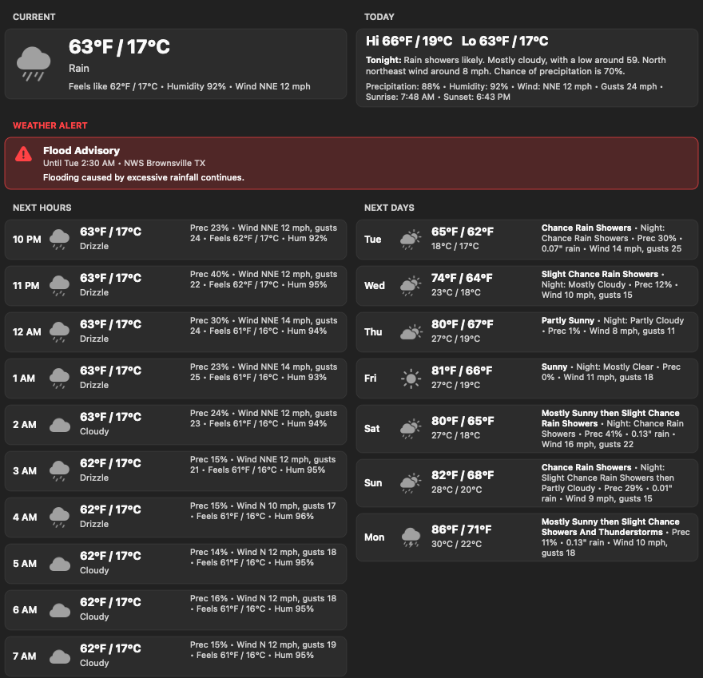

# WeatherBar

A small weather app for the Mac menu bar. It shows the current conditions with the temperature in °F
and °C and the day's high and low. Click it for the hourly and daily forecast.

## Features

- **Menu bar:** a conditions icon, the temperature in °F over °C, and the high over the low.
- **Forecast panel:** current conditions and the day ahead at the top, then the hours and days ahead.
  You choose how many in Settings, up to 48 hours and 14 days. Every temperature is shown in both °F
  and °C.
- **Forecaster wording (US):** each day reads like "Mostly Cloudy then Chance Light Rain", with the
  night's outlook. Hover over a day for the full forecast. The Weather Service covers 7 days; days
  after that show a one-word summary.
- **Weather alerts (US):** warnings, watches and advisories appear in a red band, and a red dot appears
  on the menu bar icon.
- **Your location:** uses the Mac's location, or a place you choose in Settings.
- **Keeps itself up to date:** checks for new versions twice a day and when the Mac wakes, shows what
  changed, and installs with one click.

| Settings | About |
|---|---|
|  |  |

## Requirements

An Apple Silicon Mac with macOS 13 or later.

## Install

1. Download `WeatherBar-<version>.zip` from the [Releases](../../releases) page and unzip it.
2. Right-click `WeatherBar.app` and choose **Open**. WeatherBar isn't from the App Store, so macOS asks
   you to confirm the first time.
3. When WeatherBar offers to move itself to the Applications folder, let it. Updates install there.
4. Allow Location when asked, or pick a place in **Settings…**.
5. Optional: turn on **Start WeatherBar at login** in Settings.

After that, updates arrive on their own. **Check for Updates…** in the menu looks right away.

## Data and credits

- Weather from [Open-Meteo](https://open-meteo.com).
- US forecast wording and alerts from the [National Weather Service](https://www.weather.gov).
- Icons are Apple SF Symbols.

Building it yourself, the settings you can change from Terminal, and how updates and releases work are
in [DEVELOPMENT.md](DEVELOPMENT.md).

## License

Copyright 2026 Duane May. Licensed under the [Apache License, Version 2.0](LICENSE).
