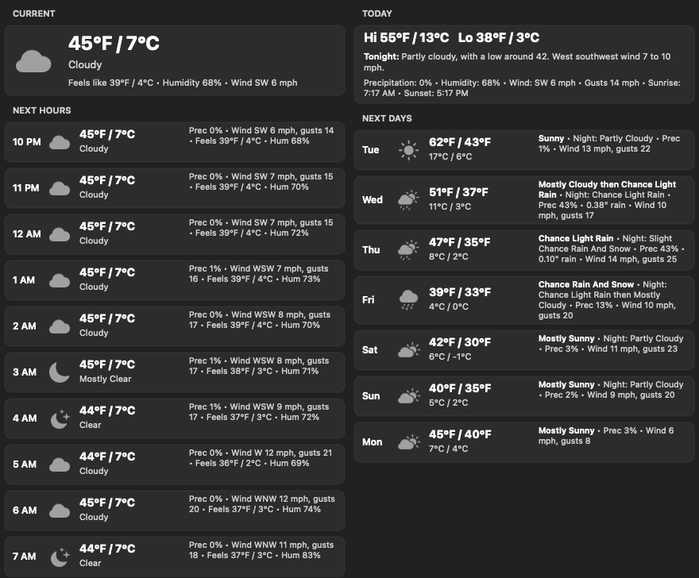
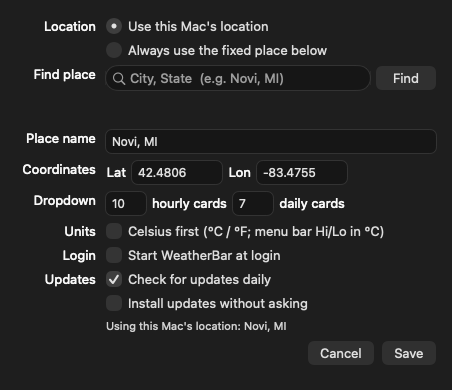
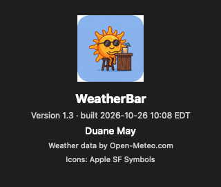

# WeatherBar

A small native macOS menu bar weather app. The menu bar shows the current conditions icon with two
stacked columns: the current temperature in °F over °C, and today's high over low. Click it for a
two-column forecast panel.



## Features

- **Menu bar:** conditions icon plus `56°F  H 65°` over `13°C  L 47°`, drawn as a template image so
  it follows light and dark menu bars.
- **Dropdown, left column:** current conditions (temperature in both units, feels-like, humidity,
  wind), then the next 10 hours with temperature, conditions, precipitation chance, wind and gusts,
  feels-like and humidity.
- **Dropdown, right column:** today's high and low, conditions, precipitation, humidity, wind,
  gusts, sunrise and sunset, then the next 7 days with highs, lows, conditions, precipitation chance,
  rain amount, wind and gusts. In the US, the conditions are the National Weather Service's own wording
  for each day and night; hover over a day for the full forecast.
- **Both units everywhere.** A Celsius-first setting flips every temperature, including the menu
  bar's high and low.
- **Location:** uses this Mac's location through Location Services and shows it as "City, ST". If
  that is denied or unavailable it falls back to a fixed place, Novi, MI by default.
- **Settings window:** Mac location or fixed place, place search by name, card counts, Celsius
  first, start at login.
- **Open Weather App** opens Apple's Weather app. **Refresh** fetches immediately; otherwise it
  refreshes every 10 minutes and on wake from sleep.
- **Updates itself** from this repo's GitHub Releases. It checks at launch, every 12 hours, and when
  the Mac wakes, so a release published at night shows up the next morning. It offers
  to install a newer version, then downloads it, verifies it, swaps it in place and relaunches. The
  menu also has **Check for Updates…**.
- **About window** with version and build date.

| Settings | About |
|---|---|
|  |  |

## Requirements

- Apple Silicon Mac, macOS 13 or later. Intel is not supported.
- To build: Xcode Command Line Tools (`xcode-select --install`). Full Xcode is not needed.

## Install

**From a release:** download `WeatherBar-<version>.zip` from the
[Releases](../../releases) page, unzip, and open `WeatherBar.app`. It is ad-hoc signed, not
notarized, so the first launch needs right-click, then Open. Or clear the quarantine flag:

```bash
xattr -dr com.apple.quarantine WeatherBar.app
```

On first launch it offers to move itself to /Applications. Let it: self-update needs a folder it can
write to, and the login item points at wherever the app is. Then turn on **Start WeatherBar at
login** in Settings.

## Updates

WeatherBar asks `api.github.com/repos/duanemay/weatherbar/releases/latest` for the newest release at
launch, every 12 hours, and on wake from sleep when the last check is over an hour old. When it finds a newer version it shows the release notes with **Install
and Relaunch**, **Later** and **Skip This Version**. Settings has one **Updates** menu: **Ask before installing** (the default),
**Install automatically**, or **Don't check automatically**. Check for Updates… in the menu works with
any of them.

Before anything is replaced, the download must pass four checks, and a failure leaves the installed
app untouched:

1. Its SHA-256 matches the `.sha256` file published with the release.
2. Its bundle identifier is `com.mayhoo.weatherbar`.
3. Its version matches the release tag.
4. Its code signature verifies.

The new copy is unpacked beside the old one. After WeatherBar quits, a short script swaps the two,
restores the old copy if the swap fails, and relaunches. The checks need the repository to be public,
because GitHub's release API returns 404 to unauthenticated requests for a private repo.

Releases are ad-hoc signed, not signed with an Apple Developer ID. macOS ties some permissions to the
signature, so it may ask for Location access again after an update.

**From source:**

```bash
./build.sh       # builds build/WeatherBar.app
./install.sh     # copies it to /Applications and launches it
```

## Settings from the command line

Everything in the Settings window is a `defaults` key. Quit and relaunch after changing one.

```bash
defaults write com.mayhoo.weatherbar useLocation  -bool true     # use this Mac's location (default)
defaults write com.mayhoo.weatherbar useNWS       -bool false    # skip National Weather Service wording
defaults write com.mayhoo.weatherbar place        -string "Novi, MI"
defaults write com.mayhoo.weatherbar latitude     -float 42.4806
defaults write com.mayhoo.weatherbar longitude    -float -83.4755
defaults write com.mayhoo.weatherbar celsiusFirst -bool true     # °C first, bar high/low in °C
defaults write com.mayhoo.weatherbar hours        -int 10        # hourly cards
defaults write com.mayhoo.weatherbar days         -int 7         # daily cards
defaults write com.mayhoo.weatherbar menuWidth    -float 440     # width of each dropdown column
defaults write com.mayhoo.weatherbar refreshMinutes -int 10
defaults write com.mayhoo.weatherbar fontSize     -float 9       # menu bar text size
defaults write com.mayhoo.weatherbar bigTemp      -bool true     # add a large temp before the columns
defaults write com.mayhoo.weatherbar skipMovePrompt -bool true   # never offer to move to /Applications
defaults write com.mayhoo.weatherbar updateMode -string ask         # ask (default), auto, or off
defaults write com.mayhoo.weatherbar updateCheckHours -float 12     # hours between scheduled checks
```

## Development

The whole app is one file, `main.swift`, using AppKit, CoreLocation and ServiceManagement. There is
no Xcode project.

| File | Purpose |
|---|---|
| `main.swift` | The app: data fetch, menu bar drawing, dropdown cards, Settings and About windows. |
| `Info.plist` | Bundle metadata. Menu bar only (`LSUIElement`), location permission text, version. |
| `build.sh` | Compiles with `swiftc`, builds `AppIcon.icns` from `icon.png`, stamps the build date, ad-hoc signs. |
| `install.sh` | Copies the built app to /Applications and launches it. |
| `icon.png` | App icon source, 1024 × 1024. |
| `docs/` | Screenshots and the alternate icon candidate. |

**Test modes** run headless, which is useful over SSH or in CI:

```bash
B=build/WeatherBar.app/Contents/MacOS/WeatherBar
$B --once                          # print one fetch to stdout
$B --geocode "East Lansing"        # test the place search
$B --render out.png [--light]      # draw the dropdown to a PNG
$B --render-settings out.png       # draw the Settings window
$B --render-about out.png          # draw the About window
$B --check-update                  # ask GitHub Releases for a newer version
$B --apply-update                  # download, verify and install a newer version in place
```

**Testing the updater** without GitHub: serve a release JSON and zip locally and point the app at it
with `defaults write com.mayhoo.weatherbar updateFeedURL -string http://127.0.0.1:8765/release.json`,
then run `--apply-update`. Delete the key afterwards.

**Versioning:** the version lives in `Info.plist` (`CFBundleShortVersionString`). Bump it there,
commit, then tag `v<version>` to publish a release. Installed copies pick it up within 12 hours, or at the next wake.

## Continuous integration

`.github/workflows/build.yml` runs on every push to `main`, on pull requests, and on demand. On an
Apple Silicon macOS runner it:

1. Builds the app with `build.sh`.
2. Checks the bundle: valid plist, icon present, arm64 binary, valid signature.
3. Smoke-tests a live weather fetch and a place search. These don't fail the build if the weather
   service is unreachable.
4. Renders the dropdown, Settings and About windows to PNGs.
5. Zips the app, writes its SHA-256 checksum, and uploads both plus the renders as build artifacts.

**Dependencies:** the app has no third-party libraries; it uses only macOS system frameworks. The
only external dependencies are the workflow's GitHub Actions, pinned to commit SHAs. Dependabot
(`.github/dependabot.yml`) checks them every Monday and opens one grouped pull request when any have a
new release.

Pushing a tag such as `v1.5` also publishes a GitHub Release with the zip and its `.sha256` file
attached. The installed apps' updater reads exactly those two files. The
release job fails if the tag doesn't match the version in `Info.plist`.

## Data and credits

- Weather numbers and place search from [Open-Meteo](https://open-meteo.com), free with no API key.
- In the US, forecast wording from the [National Weather Service](https://www.weather.gov/documentation/services-web-api)
  (`api.weather.gov`, free, no key): each day's phrase such as "Mostly Cloudy then Chance Light Rain",
  the night's phrase, and the current period's full forecast in the Today card. Hover over a day for the
  forecaster's full text. Elsewhere, or if NWS doesn't answer within 10 seconds, the cards show Open-Meteo's
  one-word conditions. The temperatures always come from Open-Meteo, so they can differ by a few degrees
  from the numbers inside the NWS text.
- Icons are Apple SF Symbols, the same family Apple Weather uses.
- **Why not Apple WeatherKit:** it requires a paid Apple Developer Program membership and an app
  signed with the WeatherKit entitlement. Switching would mean replacing `fetchWeather` with a
  `WeatherService` call and signing with a developer certificate.

## License

Copyright 2026 Duane May. Licensed under the [Apache License, Version 2.0](LICENSE).
